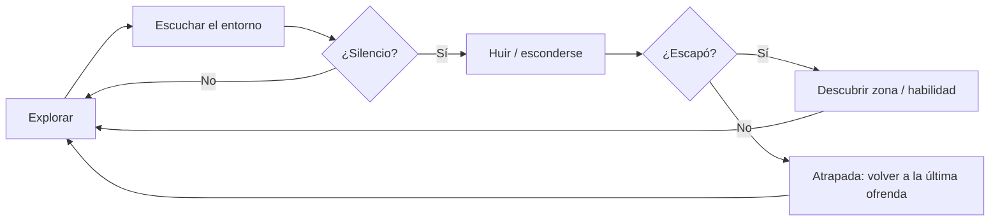
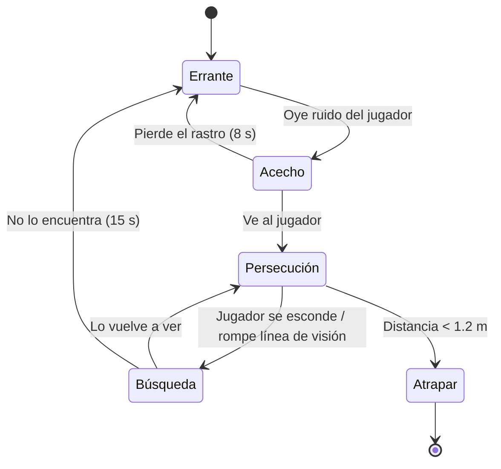
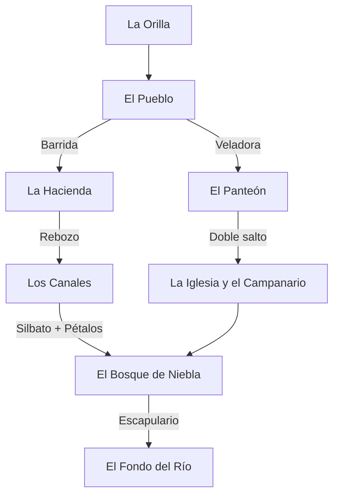

# 🌊 LAMENTO — Game Design Document

> **Metroidvania de terror 2.5D · Unity 6**
> *"Si la escuchas lejos… ya está aquí."*

| Campo | Valor |
|---|---|
| **Título provisional** | *Lamento* |
| **Género** | Metroidvania · Survival horror · Plataformas de persecución |
| **Vista** | 2.5D (jugabilidad 2D sobre escenarios 3D) |
| **Plataforma** | PC (Windows) · Navegador mediante build WebGL (objetivo secundario) |
| **Motor** | Unity 6 (6000.6.5f1) · Universal Render Pipeline (URP) |
| **Lenguaje** | C# |
| **Proyecto base** | `El_Gran_juego_3D` (repositorio `Jonathan-Bello/El_Gran_juego_3D`) |
| **Público** | 15+ · fans del terror psicológico y los metroidvania |
| **Duración estimada** | 3 – 5 horas (100 %: ~7 h) |
| **Versión del documento** | 0.2 — Adaptación a Unity (antes: Three.js) |

> **Regla para personas y agentes de IA:** este documento es la fuente de verdad del juego. Si algo no está aquí, se pregunta antes de implementarlo. Si el diseño cambia, primero se actualiza este archivo.

---

## Índice

1. [Concepto](#1-concepto)
2. [Pilares de diseño](#2-pilares-de-diseño)
3. [Historia y ambientación](#3-historia-y-ambientación)
4. [Mecánica central: el Lamento Invertido](#4-mecánica-central-el-lamento-invertido)
5. [Jugabilidad y controles](#5-jugabilidad-y-controles)
6. [La Llorona: IA y comportamiento](#6-la-llorona-ia-y-comportamiento)
7. [Progresión y habilidades](#7-progresión-y-habilidades)
8. [Mundo y diseño de niveles](#8-mundo-y-diseño-de-niveles)
9. [Dirección de arte](#9-dirección-de-arte)
10. [Diseño de audio](#10-diseño-de-audio)
11. [Interfaz (UI/UX)](#11-interfaz-uiux)
12. [Arquitectura técnica (Unity)](#12-arquitectura-técnica-unity)
13. [Accesibilidad](#13-accesibilidad)
14. [Alcance, hitos y backlog](#14-alcance-hitos-y-backlog)
15. [Riesgos](#15-riesgos)
16. [Glosario](#16-glosario)
17. [Historial de cambios](#17-historial-de-cambios)

---

## 1. Concepto

**Elevator pitch:** Eres Itzel, una niña que despierta junto al río una noche de neblina. Algo la está buscando. Para sobrevivir debes correr, saltar y descubrir un pueblo maldito interconectado… guiándote por un sonido que **miente**: el lamento de La Llorona se oye **más fuerte cuanto más lejos está**, y se apaga cuando la tienes encima.

**Fantasía del jugador:** sentirse presa, no cazador. No hay combate directo; la única defensa es moverse, conocer el mapa y aprender a leer el silencio.

**Gancho único:** la inversión del audio rompe el instinto del jugador. El silencio se vuelve la señal más aterradora del juego.

---

## 2. Pilares de diseño

| # | Pilar | Qué significa en la práctica |
|---|---|---|
| 1 | **El silencio es peligro** | Toda la tensión gira en torno al Lamento Invertido. El audio es una mecánica, no decoración. |
| 2 | **Huir es jugar** | El movimiento debe sentirse preciso y fluido; huir tiene que ser divertido incluso sin terror. |
| 3 | **Conocer el mapa es sobrevivir** | Atajos, escondites y rutas de escape son la recompensa de explorar. |
| 4 | **Folclor con respeto** | La leyenda se presenta con raíces mexicanas reconocibles, sin caricaturizarla. |
| 5 | **Azul y frío** | Una identidad visual inmediata: todo es agua, niebla y luna. |

---

## 3. Historia y ambientación

### 3.1 Premisa
En el pueblo ribereño de **San Juan del Río Hondo**, los niños desaparecen cada noche de neblina. Itzel despierta en la orilla sin recordar cómo llegó. Su hermano menor, **Tonatiuh**, no está. Las voces del pueblo dicen que *ella* se lo llevó al fondo del río.

### 3.2 Estructura narrativa
- **Acto I — La orilla:** Itzel aprende a huir. Descubre que La Llorona no la quiere matar: la quiere *llevar*.
- **Acto II — El pueblo hundido:** Explora el pueblo, la hacienda y el panteón. Encuentra fragmentos de la historia de la mujer que se convirtió en La Llorona.
- **Acto III — El fondo:** Desciende al río para recuperar a su hermano y enfrentar el lamento cara a cara.

### 3.3 Narrativa ambiental
La historia se cuenta sobre todo con:
- **Ofrendas** (puntos de guardado) con fotos, veladoras y objetos.
- **Cartas y recortes** coleccionables.
- **Ecos**: fragmentos de voz que se escuchan al pasar por ciertos lugares.

### 3.4 Finales
| Final | Condición |
|---|---|
| **Final del río** | Terminar el juego sin recolectar todos los recuerdos. Itzel escapa con su hermano, pero el lamento continúa. |
| **Final del descanso** | Reunir todos los recuerdos y llevarlos a la ofrenda final. La Llorona encuentra paz. |

---

## 4. Mecánica central: el Lamento Invertido

> **Regla de oro:** cuanto más **débil** suena el lamento, más **cerca** está La Llorona.

### 4.1 Estados de percepción

| Distancia real | Lo que escucha el jugador | Señales visuales |
|---|---|---|
| **Muy lejos** (> 40 m) | Lamento fuerte, con mucha reverberación, rebota por todo el escenario. | Ninguna. |
| **Lejos** (25 – 40 m) | Lamento claro y constante: *"¡Ay, mis hijos!"* | Niebla normal. |
| **Media** (12 – 25 m) | El lamento baja de volumen y se vuelve intermitente. | La niebla se espesa ligeramente. |
| **Cerca** (5 – 12 m) | Casi inaudible. Un susurro seco, sin eco. El ambiente (grillos, agua) **también se apaga**. | Escarcha en los bordes de la pantalla. |
| **Encima** (< 5 m) | **Silencio total.** Solo la respiración de Itzel y su corazón. | Viñeta azul, aliento visible, luces que parpadean. |

### 4.2 Fórmula de audio

Se normaliza la distancia `d` entre 0 (contacto) y 1 (distancia máxima audible). En Unity se calcula cada frame en `LamentoInvertido.cs`:

```csharp
// d = Mathf.Clamp01(distancia / distMax);
float volumenLamento  = 0.02f + 0.98f * Mathf.Pow(d, 1.6f);   // cerca = casi nada
float mezclaReverb    = d;                                     // lejos = mucho eco
float volumenAmbiente = Mathf.SmoothStep(0f, 1f, Mathf.InverseLerp(0.1f, 0.4f, d)); // el mundo se calla cerca de ella
float volumenCorazon  = 1f - Mathf.SmoothStep(0f, 1f, Mathf.InverseLerp(0.0f, 0.3f, d)); // el corazón sube cuando está encima
```

- La **dirección** del sonido (paneo estéreo) **sí es verdadera**: el jugador sabe hacia dónde huir, pero no qué tan rápido. En Unity se usa `AudioSource.panStereo` calculado con la posición X relativa (no el audio 3D nativo, porque su atenuación es la contraria a la que queremos).
- El exponente `1.6` y los umbrales se exponen como campos públicos y se ajustan en pruebas de juego.

### 4.3 Por qué funciona
1. Rompe el reflejo aprendido de "fuerte = peligro".
2. Convierte el silencio en un recurso dramático.
3. Obliga a escuchar el **ambiente** además del lamento: cuando los grillos callan, hay que correr.

### 4.4 Curva de aprendizaje
- **Tutorial (Acto I):** el juego muestra de forma explícita la relación con una escena guiada (la Llorona aparece a lo lejos con lamento fuerte y luego se acerca en silencio). Se implementa con **Timeline**.
- **Refuerzo:** las primeras persecuciones usan señales visuales generosas; se reducen conforme avanza el juego.

---

## 5. Jugabilidad y controles

### 5.1 Bucle de juego



### 5.2 Movimiento base

El movimiento ocurre solo en los ejes **X** (horizontal) e **Y** (vertical). El eje **Z** está bloqueado para el jugador (ver 12.3).

| Acción | Descripción |
|---|---|
| **Caminar** | Silencioso. Velocidad 3.5 m/s. |
| **Correr** | Hace ruido (atrae a La Llorona). Velocidad 6.5 m/s. Consume aliento. |
| **Saltar** | Altura variable según tiempo de pulsación. *Coyote time* de 100 ms y *jump buffer* de 120 ms. |
| **Agacharse** | Reduce ruido y permite pasar por huecos bajos. |
| **Esconderse** | En armarios, bajo camas, detrás de lápidas o entre carrizos. |
| **Interactuar** | Puertas, palancas, ofrendas, objetos. |

> Nota: el doble salto **no** es parte del movimiento base; se desbloquea como habilidad (sección 7). El `sus_control.cs` actual ya lo implementa y se reutiliza con `saltosMaximos = 1` hasta obtener la habilidad.

### 5.3 Aliento (stamina)
- Barra de aliento que se gasta al correr y saltar repetidamente.
- Al agotarse, Itzel jadea (hace ruido) y baja la velocidad.
- Se recupera caminando o escondida.

### 5.4 Ruido del jugador
Cada acción genera un valor de **ruido** que La Llorona puede detectar. Se implementa con un evento `RuidoEmitido(posición, radio)` que escucha la IA:

| Acción | Radio de ruido |
|---|---|
| Caminar | 2 m |
| Correr | 10 m |
| Aterrizar desde gran altura | 14 m |
| Pisar charcos | 8 m |
| Jadear (sin aliento) | 6 m |

### 5.5 Controles

Se usa el **Input System** de Unity con el asset `InputSystem_Actions.inputactions` (mapa `Player`). Teclado y mando funcionan sin código adicional.

| Acción | Teclado | Mando |
|---|---|---|
| Mover | `A` / `D` o flechas | Stick izquierdo |
| Saltar | `Espacio` | `A` / `✕` |
| Correr | `Shift` (mantener) | `RT` / `R2` |
| Agacharse / bajar | `S` | Stick abajo |
| Interactuar / esconderse | `E` | `X` / `□` |
| Habilidad equipada | `Q` | `Y` / `△` |
| Mapa | `M` | `Select` |
| Pausa | `Esc` | `Start` |

### 5.6 Muerte y reaparición
- Si La Llorona atrapa a Itzel: secuencia breve (sin gore) en la que es arrastrada al agua y pantalla en negro.
- Reaparece en la **última ofrenda visitada**.
- Los objetos clave conseguidos se conservan; los atajos abiertos permanecen abiertos.
- Caer en una zona con tag `DeathZone` usa la misma reaparición.

---

## 6. La Llorona: IA y comportamiento

### 6.1 Máquina de estados



| Estado | Comportamiento | Velocidad |
|---|---|---|
| **Errante** | Recorre puntos de patrulla cercanos al agua. Lamento constante. | 2 m/s |
| **Acecho** | Va hacia el último ruido detectado. | 4 m/s |
| **Persecución** | Sigue directamente al jugador; flota sobre huecos cortos. | 6 m/s (un poco más lenta que correr) |
| **Búsqueda** | Revisa escondites cercanos al azar. | 3 m/s |
| **Atrapar** | Animación de captura. | — |

Implementación: `LloronaIA.cs` con un `enum EstadoLlorona` y un `switch` en `Update`. La línea de visión se comprueba con `Physics.Raycast` hacia el jugador. Los puntos de patrulla son `Transform` asignados en el Inspector.

### 6.2 Reglas especiales
- **Atraviesa paredes delgadas** y puertas cerradas, pero **no** puertas selladas con veladoras.
- **Aparece desde el agua:** cualquier cuerpo de agua es un punto de entrada posible.
- **Teletransporte por niebla:** si el jugador se aleja demasiado (> 60 m), puede reaparecer a 30–40 m en la dirección de avance del jugador. Siempre llega con lamento **fuerte** primero (está "lejos"), para que el jugador tenga oportunidad de reaccionar.
- **Escondites:** si el jugador se esconde mientras está en Búsqueda y cerca, hay una minifase de **contener la respiración** (mantener un botón con el ritmo del corazón).

### 6.3 Dirección dramática ("AI Director")
Un sistema controla la tensión para que no sea agobiante todo el tiempo:
- Mide la **tensión acumulada** (tiempo en persecución, capturas recientes).
- Si la tensión es alta, La Llorona se mantiene lejos un tiempo (fase de **respiro**).
- Si es baja por mucho tiempo, provoca un acercamiento.
- Zonas **seguras** (ofrendas, iglesia) donde nunca entra.

---

## 7. Progresión y habilidades

Como todo metroidvania, cada habilidad abre nuevas rutas del mapa. **Ninguna es un arma**: todas sirven para moverse, esconderse o despistar.

| # | Habilidad | Objeto | Efecto | Abre acceso a |
|---|---|---|---|---|
| 1 | **Barrida** | Huaraches viejos | Deslizarse bajo obstáculos corriendo. | Ductos y huecos bajos. |
| 2 | **Veladora** | Veladora de la ofrenda | Ilumina un área; revela **plataformas espectrales** y sella puertas temporalmente. | Zonas oscuras, rutas ocultas. |
| 3 | **Rebozo** | Rebozo de la abuela | Planear lentamente en el aire. | Abismos y caídas largas. |
| 4 | **Doble salto** | Listón de la virgen | Segundo salto en el aire. | Torres, campanario. |
| 5 | **Silbato de barro** | Silbato de pájaro | Emite un eco que revela **por 3 s** la posición exacta de La Llorona… y la atrae. | Puzles de distracción. |
| 6 | **Pétalos de cempasúchil** | Puñado de flores | Deja un rastro que la ralentiza 50 % por 4 s. | Persecuciones largas. |
| 7 | **Escapulario** | Escapulario de Tonatiuh | Permite nadar 5 s sin que ella emerja. | El río y el Fondo. |

Implementación: cada habilidad es un `ScriptableObject` (`HabilidadSO`) y el jugador guarda las desbloqueadas en un `HashSet`.

### 7.1 Mejoras menores (coleccionables)
- **Milagritos** (×10): cada 3 aumentan la barra de aliento.
- **Recuerdos** (×12): fragmentos de historia; necesarios para el final del descanso.
- **Fotos del mapa** (×6): revelan secciones del mapa.

### 7.2 Mapa de dependencias



---

## 8. Mundo y diseño de niveles

### 8.1 Zonas

| Zona | Ambiente | Peligro especial | Habilidad que contiene |
|---|---|---|---|
| **La Orilla** (tutorial) | Ribera con carrizos, muelle roto. | Aprendizaje del lamento. | — |
| **El Pueblo** | Calles empedradas, casas de adobe, tendederos. | Perros que ladran (hacen ruido). | Barrida |
| **La Hacienda** | Casona abandonada, pasillos largos. | Pisos de madera ruidosos. | Rebozo |
| **El Panteón** | Tumbas, mausoleos, cempasúchil. | Oscuridad total. | Veladora, Pétalos |
| **Los Canales** | Trajineras, puentes, agua por todas partes. | Ella puede salir de cualquier canal. | Silbato |
| **La Iglesia** | Interior con vitrales, campanario. | **Zona segura** parcial. | Doble salto |
| **El Bosque de Niebla** | Árboles altos, visibilidad mínima. | La niebla oculta plataformas. | Escapulario |
| **El Fondo del Río** | Pueblo hundido bajo el agua, irreal. | Persecución final. | — |

Cada zona es una **escena de Unity** (`Zona_Orilla.unity`, `Zona_Pueblo.unity`, …). Las salas dentro de una zona se cargan con escenas aditivas o como prefabs grandes.

### 8.2 Reglas de diseño de niveles
- **Toda sala tiene al menos dos salidas** o un escondite: el jugador nunca debe quedar atrapado sin opciones.
- **Atajos en un solo sentido** que se abren desde el lado "lejano" (recompensa por explorar).
- **Persecuciones guionizadas** (set pieces) al obtener cada habilidad: la nueva habilidad es la clave para escapar.
- **Ofrendas** cada 3–5 salas como máximo.
- **Señalización por luz:** las rutas principales tienen luz cálida tenue (el único color no azul del juego).

### 8.3 Profundidad 2.5D
Aunque la jugabilidad es en un plano, el escenario aprovecha la profundidad:
- **Capa de fondo (Z +5 a +20):** paisaje, La Llorona errante a lo lejos (se ve pasar sin llegar al plano de juego).
- **Capa de juego (Z = 0):** plataformas, jugador, enemiga en persecución.
- **Capa frontal (Z −2 a −6):** carrizos, rejas, ramas que tapan parcialmente la vista y generan sustos.
- **Transiciones de profundidad:** puertas y escaleras que llevan al jugador "hacia adentro" del escenario, con un giro suave de cámara (blend de Cinemachine).

> **Convención fijada (v0.3, con `Zona_Orilla.unity`):** la cámara está en Z negativa (≈ −18 m) y mira hacia **+Z**. Así, +X es la derecha de la pantalla, el **fondo está en Z positiva** y el **frente en Z negativa**.

---

## 9. Dirección de arte

### 9.1 Estilo
**Low-poly estilizado** con iluminación dramática, niebla volumétrica y texturas pintadas a mano en baja resolución. Inspiración: grabados mexicanos antiguos, fotografía nocturna en tonos fríos, teatro de sombras.

### 9.2 Paleta de colores (azulada)

| Muestra | Nombre | HEX | Uso |
|---|---|---|---|
| 🟦 | **Abismo** | `#050B1A` | Fondos más lejanos, negro principal. |
| 🟦 | **Noche de río** | `#0B1D3A` | Cielo y sombras. |
| 🟦 | **Agua profunda** | `#123A63` | Superficies de agua, muros. |
| 🟦 | **Azul neblina** | `#2C5F8A` | Niebla, plataformas medias. |
| 🟦 | **Luna fría** | `#6FA3C7` | Bordes iluminados, rim light. |
| ⬜ | **Velo** | `#B8D8EB` | La Llorona, espectros, escarcha. |
| ⬜ | **Aliento** | `#E6F3FA` | Brillos, texto principal. |
| 🟧 | **Veladora** *(acento)* | `#E8A84A` | Única luz cálida: ofrendas, rutas, veladora. |
| 🟥 | **Herida** *(acento mínimo)* | `#8C2F3A` | Solo en momentos clave de la historia. |

> Regla: el **90 %** de la pantalla debe estar en tonos azules. El ámbar se reserva para **seguridad y guía**, lo que lo vuelve significativo.

### 9.3 Personajes
- **Itzel:** silueta pequeña, vestido claro y rebozo; tiene que leerse bien contra fondos oscuros.
- **La Llorona:** figura alta y estilizada, vestido blanco que se funde con la niebla, cabello largo que flota como si estuviera bajo el agua. Rostro **nunca visible por completo**. Shader de translucidez (Shader Graph, URP) con bordes en `#B8D8EB`.
- **Tonatiuh:** solo aparece en recuerdos y al final.

### 9.4 Efectos visuales (post-procesado en URP)
- **Niebla exponencial** en *Lighting > Environment* (modo Exponential Squared) con color `#0B1D3A`.
- **Bloom** suave en veladoras y en La Llorona (Volume de URP).
- **Viñeta y Film Grain** (Volume de URP) que aumentan con la cercanía: un script ajusta el `weight` de un Volume local según `d`.
- **Escarcha** en los bordes de la pantalla: material de pantalla completa (Full Screen Pass Renderer Feature) cuando ella está cerca.
- **Aberración cromática** leve solo durante la captura.

---

## 10. Diseño de audio

El audio **es** la mecánica principal, por lo que recibe la máxima prioridad.

### 10.1 Capas

| Capa | Contenido | Comportamiento |
|---|---|---|
| **Lamento** | Llanto, *"¡Ay, mis hijos!"*, quejidos. | Volumen **inverso** a la distancia. Paneo real. |
| **Ambiente** | Grillos, agua, viento, perros lejanos. | Se apaga cuando ella está cerca. |
| **Jugador** | Pasos según superficie, respiración, corazón. | Respiración y corazón suben con el peligro. |
| **Música** | Drones graves, guitarra y salterio lejanos. | Casi ausente; solo en zonas seguras y momentos de historia. |
| **Sustos** | Golpes, susurros puntuales. | Usados con moderación (máximo uno por zona). |

### 10.2 Implementación en Unity
- Un **AudioMixer** (`MezclaLamento.mixer`) con grupos: `Lamento`, `Ambiente`, `Jugador`, `Musica`, `Sustos`.
- El grupo `Lamento` tiene un efecto **SFX Reverb**; su nivel *dry/wet* se expone como parámetro y lo controla `LamentoInvertido.cs` (lejos = más eco).
- **Paneo:** `AudioSource.panStereo` según la posición X de La Llorona respecto al jugador.
- **Paredes:** efecto **Lowpass** en el grupo `Lamento`, activado cuando un `Physics.Raycast` entre jugador y Llorona choca con una pared.
- El volumen de cada grupo se controla con `AudioMixer.SetFloat` (en decibeles: `20 * log10(volumen)`).
- Los `AudioSource` del lamento usan **spatialBlend = 0** (2D) para que la atenuación nativa de Unity no contradiga la mecánica.
- Se recomienda **usar audífonos** (aviso en la pantalla de inicio).

### 10.3 Voces
- Lamento grabado con actriz de voz; varias tomas para evitar repetición.
- Frases en español y algunas en náhuatl para los ecos del pasado.

---

## 11. Interfaz (UI/UX)

### 11.1 HUD minimalista
- **Sin barra de vida.** El peligro se comunica con audio y efectos de pantalla.
- **Aliento:** un aro sutil alrededor de Itzel que solo aparece al gastarse.
- **Habilidad equipada:** ícono pequeño en la esquina inferior izquierda.
- **Subtítulos** de lamentos y ecos (activables).

Implementación: **uGUI** con **TextMeshPro** (paquete `com.unity.ugui` ya instalado).

### 11.2 Menús
- **Inicio:** el río de noche con el lamento de fondo (fuerte = ella está lejos… por ahora).
- **Mapa:** estilo pergamino azul, salas descubiertas, ofrendas marcadas en ámbar.
- **Inventario:** habilidades, recuerdos y milagritos.
- **Opciones:** audio por capas, sensibilidad de mando, accesibilidad, calidad gráfica.

### 11.3 Tipografía
- Títulos: tipografía serif con aire antiguo (ej. *IM Fell English* o similar de licencia libre), convertida a font asset de TextMeshPro.
- Texto: sans-serif legible (ej. *Inter*).

---

## 12. Arquitectura técnica (Unity)

### 12.1 Stack

| Área | Tecnología |
|---|---|
| Motor | **Unity 6 (6000.6.5f1)** |
| Render | **Universal Render Pipeline (URP)** — perfiles `PC_RPAsset` y `Mobile_RPAsset` ya incluidos |
| Lenguaje | **C#** |
| Física | **Rigidbody + colliders 3D** con posición Z y rotaciones congeladas (*Constraints*) |
| Input | **Input System** (`InputSystem_Actions.inputactions`) |
| Audio | **AudioSource + AudioMixer** de Unity |
| Post-procesado | **Volumes de URP** (Bloom, Vignette, Film Grain, Chromatic Aberration) + Full Screen Pass |
| Cámara | **Cinemachine** (paquete a instalar) |
| Secuencias | **Timeline** (ya instalado) |
| Niveles | Escenas de Unity por zona + prefabs; modelos de **Blender** exportados a **FBX** |
| Guardado | JSON con `JsonUtility` en `Application.persistentDataPath` (con `try/catch`) |
| Control de versiones | **Git + GitHub** con **Git LFS** para modelos, texturas y audio |
| Despliegue | Build de Windows; build **WebGL** publicado en **GitHub Pages** mediante GitHub Actions |

### 12.2 Cámara 2.5D
- Cinemachine **Camera** con **FOV bajo (30–35°)** a ~18 m del plano de juego, para un efecto casi ortográfico pero con paralaje real.
- **Position Composer** con *dead zone* y *lookahead* en la dirección del movimiento.
- Durante persecuciones, se aumenta la distancia de cámara para mostrar a La Llorona detrás.
- Límites de cámara por sala con **Cinemachine Confiner**.

### 12.3 Física 2.5D
- El jugador usa `Rigidbody` con **Freeze Position Z** y **Freeze Rotation X/Y/Z**.
- La entrada vertical (W/S) **no** mueve en Z: S se usa para agacharse.
- Las colisiones de suelo se reconocen con el tag `Ground` y la normal del contacto (`normal.y > 0.5`), como ya hace `sus_control.cs`.
- *Coyote time* y *jump buffer* se cuentan con temporizadores en `Update`; la física se aplica en `FixedUpdate`.

### 12.4 Estructura del proyecto

```
El_Gran_juego_3D/
├── docs/
│   └── GDD.md                 # este documento
├── AGENTS.md                  # reglas para Codex
├── CLAUDE.md                  # reglas para Claude Code
├── Assets/
│   ├── Scripts/
│   │   ├── Core/              # GameManager, eventos, pausa
│   │   ├── Player/            # Movimiento de Itzel, aliento, ruido
│   │   ├── Enemy/             # LloronaIA, AIDirector
│   │   ├── Audio/             # LamentoInvertido, mezclador
│   │   ├── World/             # Ofrendas, transiciones, escondites
│   │   ├── UI/                # HUD, menús, mapa
│   │   └── Save/              # Guardado y carga
│   ├── Scenes/                # Una escena por zona
│   ├── Prefabs/
│   ├── Materials/
│   ├── Models/                # .fbx (Git LFS)
│   ├── Audio/                 # .wav / .ogg (Git LFS)
│   ├── Settings/              # Assets de URP y Volumes
│   └── ScriptableObjects/     # Habilidades, datos de zonas
├── Packages/
└── ProjectSettings/
```

Nota de migración: `Assets/sus_control.cs` es el controlador actual del jugador; se moverá a `Assets/Scripts/Player/` (moviendo también su `.meta` desde el editor de Unity, nunca solo desde el explorador de archivos).

### 12.5 Game loop
- Lógica de entrada y temporizadores en `Update`; física en `FixedUpdate` (Fixed Timestep 0.02 s, 50 Hz por defecto de Unity).
- Interpolación del Rigidbody del jugador activada para un movimiento suave.
- Pausa con `Time.timeScale = 0` y `AudioListener.pause = true`.
- En WebGL, pausa automática cuando la pestaña pierde el foco (`OnApplicationFocus`).

### 12.6 Presupuestos de rendimiento

| Métrica | Objetivo |
|---|---|
| FPS | 60 en laptop con gráficos integrados |
| Batches (Stats) por sala | < 150 |
| Triángulos en pantalla | < 200 k |
| Tamaño del build WebGL inicial | < 30 MB comprimido (resto por escenas/Addressables) |
| Tiempo de carga inicial (WebGL) | < 10 s en conexión de 20 Mbps |

### 12.7 Calidad gráfica escalable
- **Alta:** sombras, bloom, niebla, partículas (URP `PC_RPAsset`).
- **Media:** sin sombras dinámicas, bloom reducido.
- **Baja:** sin post-procesado, niebla simple (URP `Mobile_RPAsset`).

### 12.8 Reglas para agentes de IA
- Los agentes (Claude Code, Codex, Copilot) solo editan archivos `.cs` y `.md`.
- No editan a mano `.unity`, `.prefab`, `.asset` ni `.meta`: los cambios de escena se describen paso a paso y los hace una persona en el editor.
- Cada tarea va en una rama `ia/<tarea>` y entra a `main` por Pull Request revisado.

---

## 13. Accesibilidad

Como la mecánica central depende del sonido, la accesibilidad es **obligatoria**, no opcional.

- **Modo visual del lamento:** ondas en el borde de la pantalla cuya intensidad sigue la misma lógica invertida (ondas grandes = lejos, ondas tenues = cerca), con indicador de dirección.
- **Subtítulos** con dirección (`[← lamento lejano]`).
- **Vibración del mando** que aumenta con la cercanía (`Gamepad.current.SetMotorSpeeds`).
- **Opciones de intensidad:** reducir sustos, desactivar grano y aberración, modo sin destellos.
- **Ajuste de dificultad:** velocidad de La Llorona, cantidad de aliento.
- **Reasignación** completa de controles (rebinding del Input System).

---

## 14. Alcance, hitos y backlog

### 14.1 Hitos

| Hito | Entregable | Contenido |
|---|---|---|
| **M0 — Prototipo** | Sala gris jugable | Movimiento 2.5D, salto, cámara, Llorona básica, **Lamento Invertido funcionando**. |
| **M1 — Vertical slice** | La Orilla + El Pueblo | Arte final de 2 zonas, ofrendas, guardado, 1 habilidad, HUD. |
| **M2 — Alpha** | Todas las zonas en gris | Mapa completo, 7 habilidades, IA completa, AI Director. |
| **M3 — Beta** | Contenido completo | Arte y audio finales, historia, finales, accesibilidad. |
| **M4 — Lanzamiento** | Versión 1.0 | Pulido, optimización, build de Windows y WebGL en GitHub Pages. |

### 14.2 Backlog inicial (para Issues de GitHub)

**Prototipo (M0)**
- [ ] Agregar `docs/GDD.md`, `AGENTS.md` y `CLAUDE.md` al repositorio
- [ ] Corregir el error de compilación de `sus_control.cs` (variable `v` sin declarar)
- [ ] Crear el tag `DeathZone` en *Tags and Layers*
- [ ] Movimiento 2.5D: bloquear Z, caminar 3.5 m/s, correr 6.5 m/s con Shift
- [ ] Migrar la entrada de `Input` (antiguo) al Input System
- [ ] Coyote time (100 ms) y jump buffer (120 ms)
- [ ] Cámara 2.5D con Cinemachine (FOV bajo, dead zone, lookahead)
- [ ] Niebla azul y Volume base de URP
- [ ] `LloronaIA.cs` con estados Errante / Persecución
- [ ] `LamentoInvertido.cs`: volumen inverso a la distancia (fórmula 4.2)
- [ ] Silenciamiento del ambiente al acercarse
- [ ] Captura y reaparición en la última ofrenda

**Vertical slice (M1)**
- [ ] Escenas `Zona_Orilla` y `Zona_Pueblo`
- [ ] Transiciones entre salas
- [ ] Ofrendas y guardado en JSON
- [ ] Habilidad: Barrida
- [ ] Sistema de ruido del jugador (evento `RuidoEmitido`)
- [ ] Escondites
- [ ] Post-procesado (bloom, viñeta, escarcha)
- [ ] HUD de aliento

### 14.3 Etiquetas sugeridas para GitHub
`gameplay` · `ia` · `audio` · `arte` · `nivel` · `ui` · `tech` · `bug` · `accesibilidad` · `M0` · `M1` · `M2` · `M3`

---

## 15. Riesgos

| Riesgo | Impacto | Mitigación |
|---|---|---|
| Los jugadores no entienden el Lamento Invertido. | Alto | Tutorial explícito, señales visuales al inicio, playtests tempranos. |
| Jugar sin audífonos o sin sonido. | Alto | Aviso inicial y modo visual del lamento. |
| En WebGL, el navegador bloquea el audio hasta que el jugador interactúa. | Medio | Pantalla "Presiona para comenzar" antes de reproducir audio. |
| Rendimiento bajo en equipos modestos o en WebGL. | Medio | Calidad escalable, GPU instancing, texturas comprimidas, Addressables por zona. |
| Persecuciones frustrantes. | Medio | AI Director, ofrendas frecuentes, ajuste de dificultad. |
| Conflictos de merge en escenas y prefabs. | Medio | Una persona por escena a la vez; agentes de IA solo editan `.cs` y `.md`; *Smart Merge* (UnityYAMLMerge) configurado en Git. |
| Archivos pesados en el repositorio. | Medio | Git LFS para modelos, texturas y audio; `.gitignore` de Unity. |
| Representación superficial del folclor. | Medio | Investigación de la leyenda y revisión por personas de la comunidad. |

---

## 16. Glosario

| Término | Definición |
|---|---|
| **Lamento Invertido** | Mecánica central: el lamento suena más débil cuanto más cerca está La Llorona. |
| **Ofrenda** | Punto de guardado y zona segura. |
| **AI Director** | Sistema que regula la tensión controlando cuándo se acerca La Llorona. |
| **Coyote time** | Margen breve para saltar después de dejar una plataforma. |
| **Jump buffer** | Margen para registrar un salto pulsado justo antes de tocar el suelo. |
| **Set piece** | Secuencia de persecución diseñada a mano. |
| **Vertical slice** | Porción pequeña del juego con calidad final. |
| **Volume (URP)** | Componente de Unity que aplica efectos de post-procesado en un área o en toda la escena. |
| **ScriptableObject** | Asset de Unity para guardar datos (por ejemplo, la definición de una habilidad). |

---

## 17. Historial de cambios

| Versión | Fecha | Cambio |
|---|---|---|
| 0.1 | — | Borrador inicial pensado para Three.js + TypeScript. |
| 0.2 | 2026-11-24 | Adaptación a Unity 6: arquitectura técnica, audio con AudioMixer, post-procesado con URP, Input System, estructura del proyecto, reglas para agentes de IA y backlog M0 actualizado. |
| 0.3 | 2026-11-25 | Se fija la convención de cámara 2.5D (mira hacia +Z) y se invierte el signo Z de las capas de fondo y frente (8.3). Primer diseño de La Orilla en `docs/niveles/Zona_Orilla.md`. |

---

*Documento vivo: actualizar con cada hito y registrar los cambios importantes en el historial del repositorio.*
